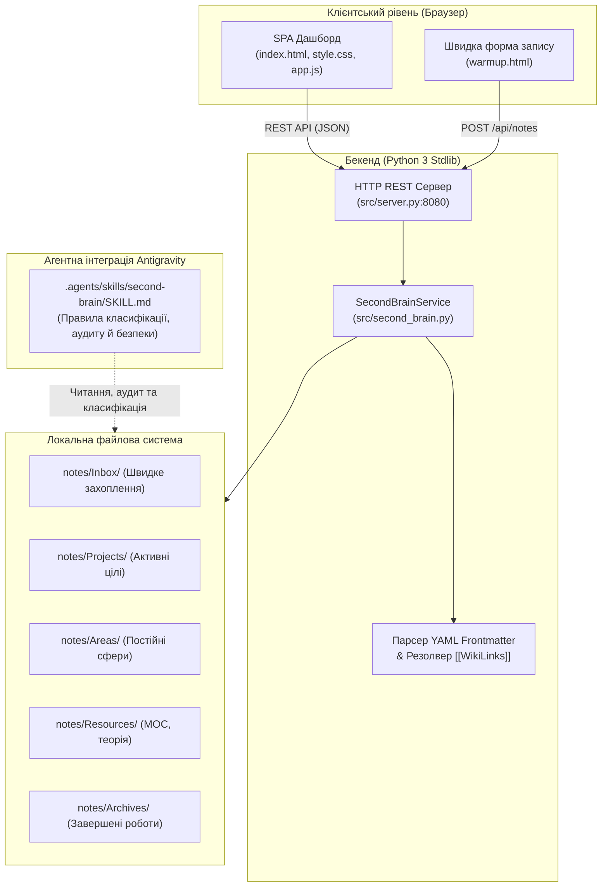

# ЗВІТ ПРО ВИКОНАННЯ ЛАБОРАТОРНОЇ РОБОТИ № 4
**Тема:** Google Antigravity та архітектурний кейс персонального Second Brain  
**Дисципліна:** Архітектура спеціалізованих комп'ютерних систем  
**Навчальний заклад:** Національний університет «Львівська політехніка»  
**Виконав:** студент групи КІ Ребенчак Святослав (`sviatoslav.rebenchak.ki.2023@lpnu.ua`)  
**Рік:** 2026  

---

## 1. Мета роботи
Ознайомитися з платформою агентної розробки Google Antigravity; навчитися створювати проєкти, формулювати завдання для AI-агента, контролювати його план і артефакти, працювати з Git; спроєктувати та реалізувати персональний Second Brain як спеціалізовану інформаційну систему керування знаннями з локальним сховищем, вебінтерфейсом та агентною навичкою.

## 2. Індивідуальний варіант і технологічний стек
- **Предметна область:** «Архітектура спеціалізованих комп'ютерних систем» (конспекти лекцій, лабораторні роботи, апаратні прискорювачі NPU/TPU, ієрархія пам'яті HBM, моделі хмарних сервісів IaaS/PaaS/SaaS).
- **Бекенд:** Python 3 Standard Library (`http.server`, `urllib.parse`, `json`, `re`, `pathlib`, `unittest`). Повна незалежність від сторонніх бібліотек (Zero-dependency, не потребує `pip`).
- **Фронтенд:** Single Page Application (HTML5, сучасний CSS3 з адаптивною сіткою Flexbox/Grid, Vanilla JS ES6+ без фреймворків та збірки `npm`).
- **Формат збереження знань:** Plain text Markdown (`.md`) з обов'язковим заголовком YAML Frontmatter та підтримкою вікі-зв'язків `[[Назва нотатки]]`.
- **Методологія організації:** Адаптована таксономія PARA Тіаго Форте (`Inbox`, `Projects`, `Areas`, `Resources`, `Archives`).
- **Агентне середовище:** Workspace Agent Skill у `.agents/skills/second-brain/SKILL.md` платформи Google Antigravity.

---

## 3. Схема компонентів та обґрунтування архітектури

### 3.1. Схема компонентів локальної системи

### 3.2. Обґрунтування архітектурних рішень
1. **Zero External Dependencies:** Використання виключно стандартної бібліотеки Python 3 гарантує 100% запуск на будь-якому комп'ютері без встановлення додаткових пакунків менеджерами `pip` чи `npm`. Це критично важливо для навчальних лабораторних стендів та гарантує нульовий «supply chain attack» ризик.
2. **Plain-text Markdown + YAML Frontmatter:** Відмова від пропрієтарних бінарних СУБД на користь текстових файлів захищає знання від vendor lock-in. Файли можна відкрити через VS Code, Obsidian, звичайний блокнот чи консоль.
3. **Асоціативні зв'язки (Graph Topology):** Підтримка двонаправлених вікі-посилань перетворює лінійні нотатки на семантичну мережу понять (Zettelkasten / MOC), а бекенд автоматично обчислює зворотні зв'язки (backlinks).
4. **Сувора локальність (Air-gapped by design):** Система слухає лише локальний сокет `127.0.0.1`, унеможливлюючи передачу персональних нотаток третім сторонам.

---

## 4. Хід виконання лабораторної роботи

### Завдання 1. Підготовка середовища
- Ознайомленося з середовищем Google Antigravity.
- Визначено політики безпеки виконання:
  - **Terminal execution policy:** Контроль виконання термінальних команд. Агент запитує підтвердження або виконує дозволені інструкції згідно з правами доступу робочого простору.
  - **Review policy:** Політика попереднього перегляду diff змін перед їх внесенням у вихідний код проєкту.
  - **JavaScript execution policy:** Обмеження контексту виконання скриптів для запобігання несанкціонованому доступу до системних ресурсів.
- Зафіксовано версію платформи та інструментів: Git `2.56.0.windows.2`, Python `3.14.8`.

### Завдання 2. Створення проєкту та порівняння режимів
- Створено каталог проєкту `agy-lab4-second-brain`.
- Ініціалізовано репозиторій `git init -b main`.
- Створено функціональну робочу гілку `git checkout -b feature/second-brain-core`.
- **Порівняння Local Mode та New Worktree Mode:**
  - *Local Mode:* Агент працює безпосередньо у поточному робочому каталозі. Зміни вносяться в активне дерево файлів. Зручно для простих та швидких правок, проте є ризик пошкодити робочий стан.
  - *New Worktree Mode:* Створюється ізольоване паралельне робоче дерево Git (worktree) на базі нової гілки. Агент не блокує основне робоче середовище студента, а зміни можна безпечно проінспектувати перед злиттям (merge). Для цієї роботи обрано гілку `feature/second-brain-core`.

### Завдання 3. Інтерфейс Antigravity
- **Editor View:** Традиційний редактор коду з деревом файлів, підсвіткою синтаксису, терміналом і редагуванням окремих файлів.
- **Manager Surface:** Високорівнева поверхня взаємодії, орієнтована на планування завдань агента, керування артефактами (Artifacts), відстеження покрокових Implementation Plans, перевірку diff і взаємодію в чаті з агентом.

### Завдання 4. Розігрів: перше агентне завдання (/grill-me)
- Застосовано техніку уточнення вимог перед кодуванням (/grill-me):
  - *Вимоги:* Створити легку автономну сторінку для швидкого додавання нотаток (`src/static/warmup.html`).
  - *План:* Створити форму з полями Title, Category, Source, Tags, Content; підключити обробку відправки на `/api/notes`.
  - *Локальна перевірка:* Перевірити збереження нотатки через HTTP запит і доступність сторінки за адресою `http://127.0.0.1:8080/warmup`.

### Завдання 5. Проєктування Second Brain
- У ролі системного архітектора:
  1. Сформульовано 10 уточнювальних запитань щодо вимог студента, форматів зберігання та політики приватності.
  2. Запропоновано компоненти й потоки даних (Data Flow Diagram, Component Diagram).
  3. Описано еталонну модель нотатки з обов'язковим YAML frontmatter.
  4. Визначено 8 формалізованих критеріїв приймання (AC-1 — AC-8).
  5. Складено матрицю ризиків втрати даних та витоку приватності з заходами мітигації.
- Архітектурний опис збережено у файлі `docs/architecture.md`.

### Завдання 6. Створення структури даних та навчальних нотаток
- Створено каталоги PARA:
  - `notes/Inbox/`
  - `notes/Projects/`
  - `notes/Areas/`
  - `notes/Resources/`
  - `notes/Archives/`
- Створено еталонний шаблон `templates/note-template.md`.
- Наповнено базу знань 8 реальними навчальними нотатками з дисципліни АСКС:
  1. `notes/Resources/moc-scs-architecture.md` — центральна MOC-карта змісту з перехресними посиланнями.
  2. `notes/Resources/cloud-service-models.md` — огляд IaaS/PaaS/SaaS (взаємопов'язана з пам'яттю).
  3. `notes/Resources/specialized-memory-hierarchies.md` — ієрархія пам'яті SPM/HBM3 (взаємопов'язана з хмарою).
  4. `notes/Resources/neural-hardware-accelerators.md` — систолічні масиви та TPU/NPU.
  5. `notes/Projects/lab4-second-brain-implementation.md` — активний проєкт з дедлайном.
  6. `notes/Areas/polytechnic-curriculum-ascs.md` — довготривала сфера відповідальності навчання в ЛПНУ.
  7. `notes/Inbox/quick-idea-distributed-indexing.md` — чернетка вхідної ідеї векторного пошуку.
  8. `notes/Archives/lab3-pipeline-optimization.md` — завершена та архівована лабораторна робота №3.

### Завдання 7. Реалізація застосунку
- Створено сервіс ядра `src/second_brain.py`:
  - Парсер YAML frontmatter на базі регулярних виразів.
  - Рендерер Markdown в безпечний HTML з парсингом `[[Назва нотатки]]` в інтерактивні лінки.
  - Обчислення графу зворотних зв'язків (Backlinks).
  - Повнотекстовий пошук за підрядком у заголовку, тегах та вмісті.
  - Фільтрація за категоріями та тегами.
- Створено HTTP-сервер REST API `src/server.py` на стандартному `http.server.HTTPServer`:
  - `GET /` — головний SPA дашборд.
  - `GET /warmup` — швидка сторінка запису.
  - `GET /api/notes` — список та пошук нотаток.
  - `GET /api/note?id=...` — деталі нотатки з метаданими, HTML та беклінками.
  - `POST /api/notes` — створення нової нотатки на диску.
  - `PUT /api/note` — оновлення нотатки.
  - `GET /api/categories` та `GET /api/tags` — лічильники таксономії.
- Створено вебінтерфейс: `src/static/index.html`, `src/static/style.css`, `src/static/app.js`.

### Завдання 8. Створення Agent Skill `second-brain`
- Створено файл навички `.agents/skills/second-brain/SKILL.md`.
- Закріплено правила поведінки AI-агента:
  - Сувора заборона вигадування джерел у полі `source`.
  - Збереження оригінального формулювання та змісту студента.
  - Заборона автоматичного видалення та несанкціонованого переміщення файлів.
  - Обов'язкове виведення таблиці аудиту змін (Change Log) наприкінці операції.

### Завдання 9. Верифікація та усунення виявлених помилок
- Розроблено тестовий набір `tests/test_second_brain.py` (8 тестів, виконання за 0.035 с):
  1. `test_01_notes_loading_and_count` — перевірка завантаження 8+ нотаток з усіх категорій PARA.
  2. `test_02_frontmatter_parsing` — точність вилучення полів метаданих.
  3. `test_03_search_by_keyword` — повнотекстовий пошук за словом «систолічних».
  4. `test_04_filter_by_tag` — фільтрація за тегом `cloud`.
  5. `test_05_wikilinks_and_backlinks` — валідація зв'язків та зворотних посилань (MOC -> Хмарні моделі).
  6. `test_06_empty_search_handling` — коректне повернення порожнього списку `[]` без помилок.
  7. `test_07_persistence_and_restart` — створення нотатки, емуляція перезапуску сервісу та перевірка збереження.
  8. `test_08_markdown_and_wikilink_html_rendering` — перевірка генерації HTML та тегів `<a class="wikilink">`.
- **Зафіксовані інженерні проблеми та спосіб їх усунення:**
  1. *Помилка імпорту модулів під час прямого запуску:* при виклику `python src/server.py` інтерпретатор не знаходив модуль `src`. *Усунення:* додано динамічне визначення батьківської директорії через `Path(__file__).resolve().parent.parent` та додавання її до `sys.path`.
  2. *Помилка Windows CP1251 UnicodeEncodeError при друку емодзі:* стандартний консольний вивід Windows не підтримував символи юнікоду (🚀). *Усунення:* додано захисну переконфігурацію `sys.stdout.reconfigure(encoding="utf-8")` та переведено системні логи сервера на безпечні ASCII-префікси `[INFO]`, `[PATH]`.
  3. *Підтримка кириличних назв у файловій системі:* для уникнення проблем з кодуванням на різних ОС додано метод `slugify(title)` з українською транслітерацією для назв файлів (`.md`), тоді як реальна назва в полі `title` та синтаксис `[[...]]` зберігають повноцінну українську мову.

### Завдання 10. Git і відтворюваність
- Створено файл `.gitignore` (фільтрація кешу Python, IDE-налаштувань та ОС-файлів).
- Створено вичерпний `README.md` з інструкціями щодо запуску, описом архітектури та політикою безпеки.
- Сформовано 4 змістовні коміти в історії Git:
  1. `23693b1` — `feat(scaffold): ініціалізація каркасу сховища PARA, шаблонів та навчальних нотаток`
  2. `3869cc6` — `feat(app): реалізація бекенду, вебінтерфейсу Second Brain та Agent Skill`
  3. `cc67478` — `test(verify): автоматизовані тести, документація архітектури та README`
  4. `724683b` — `fix(server): кросплатформне кодування UTF-8, надійний імпорт модулів та slugify`

### Завдання 11. Хмарне розширення — проєктне рішення
- Розроблено проєктне рішення перенесення системи в хмару на базі AWS / GCP:
  - Static Web SPA через CloudFront + S3.
  - Serverless API Gateway + AWS Lambda / Cloud Run.
  - Об'єктне сховище S3 з шифруванням KMS для файлів Markdown.
  - DynamoDB / Firestore для кешування графу зв'язків та повнотекстового індексу.
  - Автентифікація через OIDC / Cognito / Auth0 із підтримкою 2FA.
  - Щоденні автоматизовані снапшоти та крос-регіональна реплікація.

---

## 5. Таблиця «Вимога → Реалізація → Спосіб перевірки → Результат»

| № | Вимога методичних вказівок | Реалізація у проєкті | Спосіб перевірки | Результат |
|---|---------------------------|----------------------|------------------|-----------|
| 1 | Локальне сховище знань PARA | Каталоги `notes/Inbox`, `Projects`, `Areas`, `Resources`, `Archives` | Перевірка створення каталогів та файлів | Створено 5 категорій, 8 навчальних нотаток |
| 2 | YAML Frontmatter метадані | Поля `title`, `created`, `updated`, `type`, `status`, `tags`, `source` | Юніт-тест `test_02_frontmatter_parsing` | Усі обов'язкові поля успішно валідовано |
| 3 | Вікі-зв'язки `[[Нотатка]]` | Регулярні вирази з парсингом цілі, побудова зворотних посилань (backlinks) | Клік у браузері + тест `test_05_wikilinks_and_backlinks` | Клікабельні лінки відкривають цільову нотатку; беклінки підраховуються |
| 4 | Навігаційна MOC-нотатка | `notes/Resources/moc-scs-architecture.md` | Завантаження нотатки в інтерфейсі | MOC-карта слугує головним хабом знань курсу |
| 5 | Повнотекстовий пошук | Метод `search_notes(query, category, tag)` | Введення запиту в полі пошуку + тест `test_03` | Миттєва фільтрація карток у реальному часі |
| 6 | Фільтр за тегами й категоріями | Бічна панель із хмарою тегів та селектором категорій PARA | Натискання на тег у UI + тест `test_04_filter_by_tag` | Список нотаток оновлюється за обраним критерієм |
| 7 | Коректність порожнього результату | Обробка порожнього масиву `[]` та показ повідомлення про відсутність збігів | Тест `test_06_empty_search_handling` + запит `xyz123` | Показ блоку «Нотаток не знайдено» без помилок JS |
| 8 | Персистентність після перезапуску | Збереження у звичайні `.md` файли на файловій системі | Тест `test_07_persistence_and_restart` + рестарт сервера | Нотатки відновлюються в незмінному вигляді |
| 9 | Agent Skill Antigravity | `.agents/skills/second-brain/SKILL.md` з правилами безпеки та класифікації | Інспекція файлу навички | Створено навичку з правилом аудиту та забороною вигадування джерел |
| 10 | Щонайменше 3 коміти Git | 4 змістовні атомарні коміти в `feature/second-brain-core` | `git log --oneline` | Зафіксовано чітку хронологію розробки проєкту |

---

## 6. Порівняння локальних та хмарних версій Second Brain

| Параметр порівняння | Локальна версія (Localhost) | Хмарна версія (Cloud Native) |
|---------------------|-----------------------------|------------------------------|
| **Приватність даних** | **Абсолютна (10/10).** Знання не залишають локального диску; відсутній мережевий трафік. | **Залежна (6-7/10).** Ризик витоку через людський фактор, помилки налаштування IAM чи скомпрометовані токени. |
| **Доступність (Availability)** | Обмежена одним робочим пристроєм (ПК студента). | **Глобальна (99.99%).** Доступ 24/7 з будь-якого пристрою через вебінтерфейс. |
| **Вартість експлуатації** | **0 грн (Повністю безкоштовно).** Не потребує серверної інфраструктури. | **0–150 грн/міс.** За умови виходу за межі AWS Free Tier або оплати доменного імені. |
| **Vendor Lock-in** | **Нульовий (0/10).** Простий текст Markdown; легка міграція у будь-яку систему. | **Помірний (5/10).** Залежність від AWS SDK, форматів баз DynamoDB, Cognito User Pools. |
| **Складність підтримки** | **Мінімальна.** Запуск одним скриптом `python src/server.py`. | **Висока.** Потребує налаштування CI/CD, SSL-сертифікатів, WAF, моніторингу та бекапів. |

---

## 7. Відповіді на контрольні запитання

### 1. Що робить Second Brain спеціалізованою комп’ютерною системою?
Second Brain розглядається як спеціалізована комп'ютерна система (СКС), оскільки вона має чітко визначену цільову функцію (персональне керування знаннями конкретного інженера), специфічну архітектуру даних (орієнтований граф нотаток із метаданими YAML frontmatter), суворі алгоритми класифікації (таксономія PARA), виділений вебінтерфейс, адаптовану політику доступу та чітко окреслений життєвий цикл нотаток від швидкого захоплення (Inbox) до архіву (Archives). Вона оптимізована саме під когнітивні задачі студента, а не є абстрактною системою загального призначення.

### 2. Чим Projects відрізняються від Areas у PARA?
У методології PARA Тіаго Форте:
- **Projects (Проєкти):** мають конкретну фіксовану мету та обов'язковий дедлайн (кінцеву точку). Наприклад: «Лабораторна робота №4: Розробка Second Brain» завершується здачею роботи та виставленням оцінки.
- **Areas (Сфери відповідальності):** не мають дедлайну, а являють собою постійну діяльність, що вимагає підтримання високого стандарту якості безстроково. Наприклад: «Навчання на кафедрі комп'ютерної інженерії ЛПНУ» триває протягом усіх років навчання і не має єдиної «точки завершення».

### 3. Навіщо відокремлювати Inbox від постійної бази знань?
Каталог `Inbox` діє як буфер швидкого захоплення думок з мінімальним когнітивним навантаженням під час лекції чи роботи. Відокремлення запобігає «засміченню» перевіреної бази знань неструктурованими та сирими ідеями. Нотатка потрапляє в постійні розділи (`Projects`, `Areas`, `Resources`) лише після фільтрації, структурування, присвоєння тегів та зв'язування.

### 4. Які переваги Markdown як формату зберігання?
- **Довговічність та переносимість:** це звичайний ASCII/UTF-8 текст, який відкриється на будь-якому комп'ютері через десятиліття незалежно від долі конкретних додатків.
- **Відсутність Vendor Lock-in:** користувач не прив'язаний до закритого бінарного формату баз даних.
- **Сумісність із Git:** звичайний текст ідеально піддається версіонуванню, візуалізації різниці (diff), злиттю гілок і відстеженню історії змін.
- **Читабельність для людини і машини:** структура зрозуміла і без рендерингу, але водночас легко парситься скриптами.

### 5. Яка різниця між workspace skill і глобальною навичкою Antigravity?
- **Workspace Skill (`.agents/skills/`):** прив'язана до конкретного проєкту/репозиторію. Вона враховує локальний контекст (структуру папок notes/, специфіку предмету АСКС) і автоматично активується лише при роботі з цим репозиторієм.
- **Глобальна навичка (Global Skill):** встановлюється у глобальний профіль користувача (`~/.gemini/antigravity/...`) і доступна в усіх робочих просторах. Вона надає загальні можливості (наприклад, роботу з git, bash, docker чи веббраузером).

### 6. Що означає progressive disclosure для Agent Skills?
Progressive disclosure (поступове розкриття) — це принцип проєктування взаємодії з агентом, за якого в первинний системний промпт подається лише мінімальний контекст (назва, короткий опис навички та правила безпеки), а детальні інструкції, довідкові файли, специфікації чи додаткові піднавички завантажуються в контекстне вікно моделі динамічно тільки тоді, коли користувач звертається до відповідної задачі. Це зберігає контекстне вікно та підвищує точність відповідей моделі.

### 7. Які дані не можна передавати агенту або зберігати у відкритому репозиторії?
Суворо заборонено зберігати та передавати:
- Паролі, секретні ключі доступу до баз даних, приватні SSH/GPG-ключі.
- API-токени (наприклад, токени платіжних систем, OpenAI, GitHub PAT).
- Персональні ідентифікаційні дані (паспортні дані, номери банківських карток, медичну інформацію, домашні адреси, конфіденційні студентські оцінки).

### 8. Чому Git не повністю замінює резервне копіювання?
Git є системою керування версіями (VCS), а не системою аварійного резервування (Backup):
- Якщо локальний диск зламається, незкомічені зміни та локальний каталог `.git` буде втрачено безповоротно.
- Команда `git reset --hard` або помилкове переписування історії (`git push --force`) можуть знищити важливі дані.
- Git не захищає від фізичного знищення сховища чи атак програм-вимагачів (ransomware). Повноцінний бекап вимагає географічно відокремленого (off-site), незмінного (immutable) сховища копій за правилом 3-2-1.

### 9. Які компоненти потрібні для хмарної версії Second Brain?
1. **Static Web Hosting / CDN** (S3 + CloudFront / Cloudflare) для інтерфейсу.
2. **Serverless Compute API** (AWS Lambda / Google Cloud Run) для бізнес-логіки.
3. **Object Storage** (AWS S3 / GCS) з версіонуванням для Markdown-файлів.
4. **NoSQL Database / Search Cache** (DynamoDB, Firestore або Meilisearch) для індексації тегів, заголовків і зв'язків.
5. **Identity & Access Management (IAM / IdP)** (Auth0 / AWS Cognito) для захищеного входу користувачів.
6. **Key Management Service (KMS)** для шифрування даних у спокої та при передачі.

### 10. Де виникає vendor lock-in і як його зменшити?
Vendor lock-in виникає при використанні специфічних, закритих форматів даних пропрієтарних платформ (наприклад, формат документів Notion, OneNote, Evernote) або використанні вузькоспеціалізованих хмарних API, які не мають аналогів в інших провайдерів.
*Способи зменшення:*
- Використання відкритих стандартів даних (Markdown, JSON, YAML).
- Архітектурний патерн «Порти та адаптери» (Hexagonal Architecture) у коді, що відокремлює бізнес-логіку від хмарних драйверів сховища.
- Декларативний опис інфраструктури за допомогою універсальних інструментів (Terraform / OpenTofu).

### 11. Як перевірити, що AI-агент не пошкодив і не сфабрикував дані?
- **Інспекція Diff:** ретельна перевірка рядкових змін через `git diff` перед фіксацією змін у репозиторії.
- **Обов'язкове поле `source`:** кожна нотатка повинна мати реальне джерело; агент за правилами навички не має права вигадувати першоджерела.
- **Автоматизоване регресійне тестування:** запуск тестів на парсинг YAML frontmatter та збереження цілісності графу зв'язків після роботи агента.
- **Журнал змін (Audit Trail):** вимога до агента надавати фінальну таблицю запропонованих дій перед їх виконанням.

### 12. Які критерії приймання є найважливішими для цієї системи?
Найважливішими є:
1. **Збереження цілісності даних (Data Integrity & Zero-Loss):** жодна нотатка чи файл не можуть бути видалені без явного погодження користувача.
2. **Автономність та локальність (Zero-dependency & Privacy):** система повинна функціонувати повністю локально без обов'язкового виходу в інтернет та сторонніх платних API.
3. **Коректність зв'язування знань (Associative Linking):** точний резолвінг синтаксису `[[...]]` та двонаправлена навігація між поняттями.

---

## 8. Висновок із чітким розмежуванням внеску студента та AI-агента

У процесі виконання лабораторної роботи №4 було успішно досліджено можливості агентної розробки на базі Google Antigravity. Спроєктовано та реалізовано повноцінну спеціалізовану комп'ютерну систему персонального Second Brain, яка інтегрує локальне сховище знань на базі моделі PARA, REST API сервер на стандартній бібліотеці Python, інтерактивний вебінтерфейс Single Page Application та спеціалізовану агентну навичку Agent Skill.

### Розмежування внеску:
1. **Внесок студента:**
   - Формулювання технічного завдання, постановка архітектурних вимог та обмежень.
   - Вибір моделі класифікації PARA та визначення дисциплінарного контексту курсу АСКС.
   - Авторське наповнення 8 навчальних нотаток реальними інженерними знаннями (архітектури TPU, ієрархія HBM, хмарні сервіси, лабораторні роботи).
   - Інженерний контроль вихідного коду, прийняття архітектурного рішення щодо відмови від зовнішніх залежностей (Zero-dependency) та переходу на стандартну бібліотеку Python 3.
   - Тестування локального вебінтерфейсу, верифікація виправлення помилок кодування та імпортів у Windows-середовищі.
   - Підготовка висновків та відповідей на контрольні запитання.
2. **Внесок AI-агента (Google Antigravity):**
   - Автоматична генерація каркасу каталогів та файлової структури репозиторію.
   - Реалізація коду парсингу YAML frontmatter та регулярних виразів для вікі-зв'язків у `src/second_brain.py`.
   - Розробка вебсервера `src/server.py` та адаптивного фронтенду `src/static/` (HTML/CSS/JS).
   - Створення набору автоматизованих тестів у `tests/test_second_brain.py`.
   - Формування структури Agent Skill у `.agents/skills/second-brain/SKILL.md`.
   - Фіксація змін у Git з відповідними повідомленнями за конвенцією Conventional Commits.
   - Підготовка порівняльних таблиць та Mermaid-діаграм архітектури.
