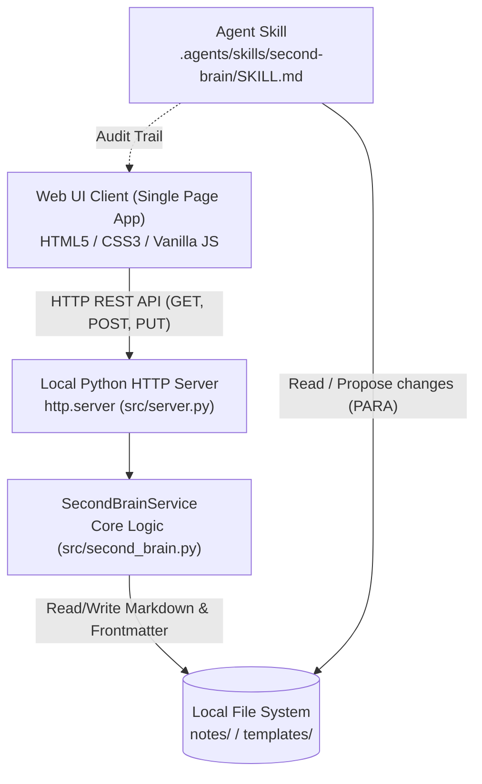
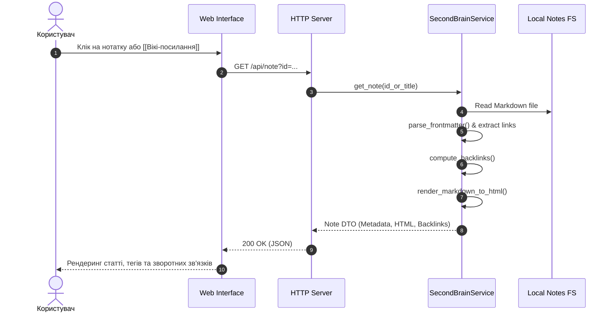
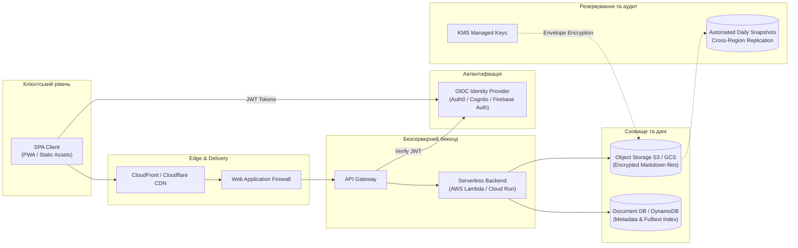

# Архітектурний опис персонального Second Brain
**Дисципліна:** Архітектура спеціалізованих комп'ютерних систем (АСКС)  
**Заклад:** Національний університет «Львівська політехніка»  
**Студент:** Святослав Ребенчак  

---

## 1. Системне проєктування персональної системи знань

### 1.1. Уточнювальні запитання системного архітектора та прийняті рішення
Під час фази проєктування системний архітектор сформував 10 ключових запитань для визначення архітектурних меж:

1. **Який цільовий профіль користувача та сценарії роботи?**  
   *Рішення:* Студент спеціальності «Комп'ютерна інженерія», що фіксує лекційний матеріал, виконує лабораторні роботи та пов'язує апаратні й програмні концепції в єдиний контекст.
2. **Який базовий формат зберігання забезпечить максимальну довговічність?**  
   *Рішення:* Відкритий формат Markdown (.md) із YAML frontmatter. Файли залишаються доступними та читабельними навіть за повної відсутності спеціалізованого програмного забезпечення або компіляторів.
3. **Як організувати таксономію нотаток?**  
   *Рішення:* Адаптована модель Тіаго Форте PARA (`Inbox` для первинного захоплення, `Projects` для задач із дедлайном, `Areas` для зон постійної відповідальності, `Resources` для тем і довідок, `Archives` для закритих активностей).
4. **Як реалізувати асоціативні зв'язки між поняттями?**  
   *Рішення:* Синтаксис двонаправлених вікі-посилань `[[Назва нотатки]]`. Бекенд парсить ці зв'язки та будує динамічний індекс зворотних посилань (backlinks).
5. **Які вимоги до автономності та незалежності від сторонніх API?**  
   *Рішення:* 100% локальна робота (Zero-cloud dependency). Система не вимагає платного доступу до хмарних LLM або пропрієтарних сервісів, унеможливлюючи витік навчальних чи персональних даних.
6. **Який мінімальний технологічний стек бекенду для максимальної відтворюваності?**  
   *Рішення:* Стандартна бібліотека Python 3 (`http.server`, `urllib`, `re`, `json`, `pathlib`) без необхідності встановлення сторонніх пакетів через `pip`.
7. **Як забезпечити швидкий пошук без важких баз даних?**  
   *Рішення:* Локальне сканування файлової структури з кешуванням індексу в оперативній пам'яті сервісу, що забезпечує пошук за підрядками в назвах, тегах та повному тексті за частки мілісекунди.
8. **Як запобігти втраті оригінальних даних при втручанні AI-агента?**  
   *Рішення:* Заборона модифікації та видалення файлів без підтвердження; створення Agent Skill із жорстким правилом аудиту та генерації Change Log перед виконанням дій.
9. **Як реалізовано навігацію за великими темами?**  
   *Рішення:* Використання MOC-нотаток (Map of Content), що виступають хабами для тематичних кластерів (наприклад, «Карта знань з архітектури СКС»).
10. **Як організовано відновлення та контроль версій?**  
    *Рішення:* Децентралізована система керування версіями Git з регулярними змістовними атомарними комітами.

---

### 1.2. Компоненти системи та потоки даних

#### Схема компонентів локальної системи


#### Потік даних при запиті нотатки та резолвінгу зв'язків


---

### 1.3. Модель нотатки

Кожна нотатка зберігається як окремий файл у відповідній директорії `notes/<Category>/<filename>.md` та має обов'язковий блок YAML frontmatter:

```markdown
---
title: "Назва нотатки"
created: YYYY-MM-DD
updated: YYYY-MM-DD
type: resource | project | area | archive | inbox
status: active | draft | archived | review
tags: [architecture, memory, hardware]
source: "реальне першоджерело інформації"
---

# Назва нотатки

## Короткий зміст
Стисле визначення концепції (1-2 речення).

## Основні твердження
- Теза 1
- Теза 2

## Пов'язані нотатки
- [[Назва іншої нотатки]]
```

#### Специфікація полів:
- `title` *(string)*: Унікальна назва сутності в базі знань.
- `created` *(ISO 8601 Date)*: Дата первинного створення.
- `updated` *(ISO 8601 Date)*: Дата останнього редагування вмісту або метаданих.
- `type` *(enum)*: Відповідність категорії PARA (`inbox`, `project`, `area`, `resource`, `archive`).
- `status` *(enum)*: Життєвий цикл нотатки (`active`, `draft`, `archived`, `review`).
- `tags` *(array of strings)*: Нормалізовані плоскі мітки для крос-категоріальної фільтрації.
- `source` *(string)*: Посилання на реальне походження матеріалу (унеможливлює галюцинації LLM).

---

### 1.4. Критерії приймання (Acceptance Criteria)
1. **AC-1 (Читання та перегляд):** Система автоматично завантажує всі нотатки з 5 директорій PARA та рендерить їх список із бейджами.
2. **AC-2 (Пошук):** Повнотекстовий пошук за підрядком фільтрує за назвою, тегами та тілом нотатки менш ніж за 50 мс.
3. **AC-3 (Фільтрація):** Користувач може фільтрувати список за категоріями PARA та за окремими тегами.
4. **AC-4 (Вікі-зв'язки):** Синтаксис `[[Назва нотатки]]` рендериться у клікабельне посилання, натискання на яке відкриває відповідну нотатку.
5. **AC-5 (Зворотні зв'язки):** Нотатка автоматично показує список усіх інших нотаток, які на неї посилаються (Backlinks).
6. **AC-6 (Створення нотатки):** Додавання нової нотатки через вебінтерфейс одразу записує файл на диск із валідним YAML frontmatter.
7. **AC-7 (Персистентність):** Перезапуск бекенд-процесу повністю зберігає всі зміни та нотатки.
8. **AC-8 (Zero-dependency):** Проєкт запускається на чистій інсталяції Python 3 без `pip install`.

---

### 1.5. Ризики щодо приватності та втрати даних

| Категорія ризику | Опис загрози | Ймовірність | Вплив | Архітектурний захист / Мітигація |
|------------------|--------------|-------------|-------|----------------------------------|
| **Витік персональних даних** | Передача чутливих даних (паролі, персональні нотатки) хмарним API | Низька (локально) | Критичний | Система працює 100% локально, без зовнішніх мережевих викликів. Застосовано суворий `.gitignore`. |
| **Втрата даних при помилці** | Випадкове перезаписування або пошкодження файлів агентом | Середня | Високий | Файлова база синхронізується через Git. Agent Skill забороняє видалення та переміщення без явної згоди. |
| **Галюцинації першоджерел** | Генерація штучним інтелектом неіснуючих джерел або авторів | Середня | Середній | Правило Agent Skill: сувора заборона вигадування поля `source`. |
| **Пошкодження frontmatter** | Некоректний синтаксис YAML руйнує роботу парсера | Низька | Середній | Автоматизовані юніт-тести та регулярні вирази з дефолтними значеннями (fallback-механізм). |

---

## 2. Хмарне розширення — проєктне рішення (Cloud Architecture)

Для забезпечення багатокористувацького доступу або синхронізації між персональними пристроями студента без прив'язки до одного комп'ютера розроблено проєктне рішення хмарного розгортання.

### 2.1. Архітектурні компоненти хмарного варіанта



1. **Статичний інтерфейс (Static Frontend):**
   - Розміщення статичних файлів у сховищі об'єктів (AWS S3 / Google Cloud Storage) з роздачею через CDN (CloudFront / Cloudflare).
   - Забезпечує миттєве завантаження, низьку затримку (Edge latency < 30 ms) та нульову вартість простою.
2. **Безсерверний бекенд (Serverless API):**
   - API Gateway + мікрофункції (AWS Lambda / Google Cloud Run).
   - Масштабування від нуля (scale-to-zero), що виключає плату за неактивні ресурси.
3. **Гібридне сховище даних:**
   - **Object Storage (S3):** Зберігає первинні Markdown-документи як immutable версії (із увімкненим S3 Object Versioning).
   - **NoSQL Cache / Index (DynamoDB / Firestore):** Зберігає нормалізовані метадані (заголовки, теги, граф зв'язків) для миттєвої фільтрації без повторного зчитування кожного файлу.
4. **Автентифікація та авторизація:**
   - OIDC / OAuth2 провайдер (AWS Cognito / Auth0 / Supabase Auth).
   - Підтримка двофакторної автентифікації (2FA) та рольового доступу (RBAC). Кожен користувач має ізольований префікс шляху `s3://second-brain-vault/<user_id>/`.
5. **Резервування та шифрування:**
   - Наскрізне шифрування у спокої (At-Rest) за допомогою KMS (AWS Key Management Service) та при передачі (In-Transit, TLS 1.3).
   - Автоматична крос-регіональна реплікація (CRR) резервних копій у додатковий дата-центр.

---

### 2.2. Порівняльний аналіз: Локальна vs Хмарна архітектура

| Критерій оцінки | Локальна архітектура (Current) | Хмарна архітектура (Proposed Cloud) |
|-----------------|--------------------------------|-------------------------------------|
| **Рівень приватності** | **Максимальний (10/10).** Дані не залишають локального накопичувача. Витік через мережу технічно неможливий без дій користувача. | **Контрольований (7/10).** Залежить від надійності шифрування, налаштувань IAM-політик та довіри до хмарного провайдера. |
| **Доступність** | Обмежена одним фізичним пристроєм (Localhost). Необхідний фізичний доступ до робочої станції. | **Глобальна (99.99%).** Доступ з будь-якого пристрою (ноутбук, планшет, смартфон) через браузер або PWA. |
| **Вартість експлуатації** | **0$ (Безкоштовно).** Використовує наявні обчислювальні потужності локального ПК. | **Мінімальна (~0-5$/міс).** За умови використання Free Tier (AWS Lambda 1M запитів, S3 5GB, Cognito 50k MAU). |
| **Vendor Lock-in** | **Нульовий (0/10).** Чисті файли Markdown та стандартний Python. Переноситься на будь-яку ОС за секунди. | **Помірний (5-6/10).** Залежність від специфічних SDK (AWS SDK, Boto3, Cognito APIs) або необхідність шару абстракції (Terraform). |
| **Складність експлуатації** | **Мінімальна.** Запуск однією командою: `python src/server.py`. Не вимагає DevOps чи адміністрування. | **Середня/Висока.** Необхідне налаштування CI/CD, DNS-записів, SSL-сертифікатів, IAM-ролей та моніторингу CloudWatch. |
